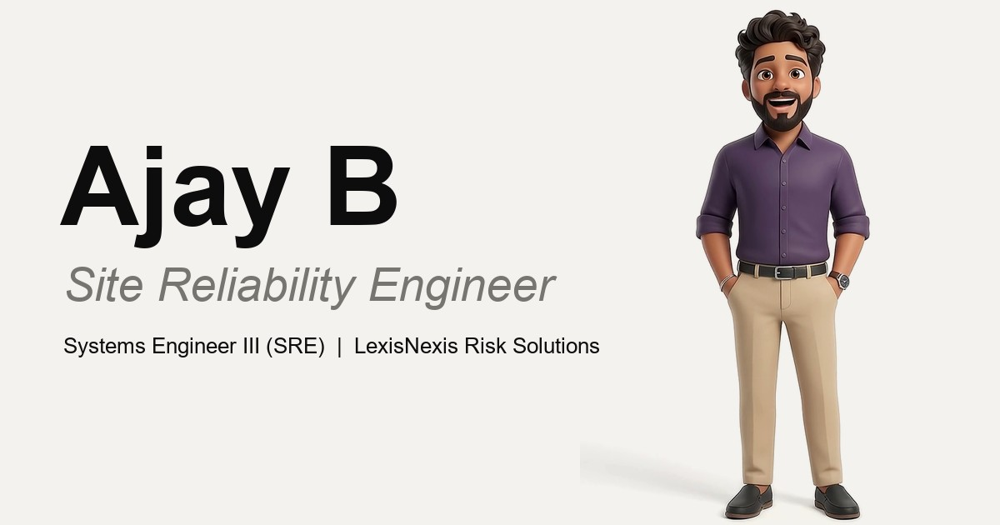

# Talking-Video Portfolio

[**Live demo →**](https://ajay-bobbili.github.io/my-portfolio/)



A quiet, premium personal portfolio where a **3D cartoon version of you introduces yourself by video** on a calm white page. This repo is Ajay B's portfolio, and it is built to be **forked and made your own**.

Built with Next.js 15 (App Router), React 19, TypeScript, Tailwind CSS 4 and Lenis. All content lives in one file, `src/lib/data.ts`. About 137 kB of first-load JavaScript, no WebGL, no GSAP, no external scripts at runtime.

> **Branch: `apple-design`.** This branch contains the original site at the repo root (same as `main`) **plus an alternative, Apple-style redesign** in [`apple-version/`](apple-version/). The live GitHub Pages site is deployed from `main` and keeps the original design; this branch is not deployed.
>
> To try the Apple-style variant:
>
> ```bash
> cd apple-version
> npm install
> npm run dev          # http://localhost:3000
> ```
>
> It uses the same content (`src/lib/data.ts`) with a different look: a frosted top bar, very large type, white and light-gray sections, rounded bento cards and swipeable project cards. Everything below describes the original site at the repo root.

## Highlights

- **Talking hero video** that plays silently on a loop; a ▶ button plays your intro once, with sound.
- **Hanging lanyard ID card** with pendulum physics that flips on hover, tap or Enter/Space.
- **"Periodic table" of skills** with brand logos and a filterable, wave-in grid.
- **Expanding accordion** for projects, **ink-flood** certification list, **scroll-drawn** timeline, and a **pinned horizontal gallery** with count-up numbers.
- White, black and gray only. Responsive from 360 px to 1920 px, keyboard accessible, respects `prefers-reduced-motion`.

---

## Make your own in 3 steps

You can have your own version in an afternoon: create a character, generate an intro video, then let an AI coding assistant build the site.

### Step 1: Create your 3D character image

Upload two images to your image generator: (1) a **reference image** that sets the outfit, pose, framing and background, and (2) **your own clear photo** for your identity. Then paste the prompt below.

> The original author's reference image is not included in this repo. Use any full-body, front-facing reference with the outfit and pose you want.

<details>
<summary><b>Character image prompt</b> (click to expand)</summary>

```text
Create a premium, high-quality 3D Bitmoji/cartoon-style full-body character portrait using the two uploaded images: use the first image as the exact visual reference for composition, outfit, pose, framing, and background, and the second as the identity reference. Recreate the composition closely with a single person standing upright in the exact same relaxed pose centered in a 16:9 landscape frame, full body visible head to feet, hands in pockets, wearing the same white button-up shirt with rolled sleeves, black trousers, and white sneakers, against a clean, plain, seamless pure-white background with soft even studio lighting, subtle natural ground shadow, straight-on eye-level view, and generous empty space. Replace only the reference person's identity with the person from the personal photo, preserving their recognizable face, facial structure, eyes, eyebrows, nose, lips, skin tone, hairstyle, hair color, body shape, natural proportions, facial expression, and overall appearance; do not copy the reference person's face or hair. Render them as a polished, friendly, premium 3D cartoon character while keeping them recognizable. Keep the outfit, pose, position, scale, camera angle, lighting, and background consistent with the reference. No text, logos, props, furniture, scenery, extra characters, unnecessary accessories, cropping, distortion, or exaggerated features. Output one clean, high-resolution 16:9 image
```

</details>

### Step 2: Create your intro video in Google Flow

Upload the image from Step 1 to **Google Flow**, then paste the prompt below. **Replace the spoken script (name, role and introduction) with your own** before generating, and change "her" to the pronoun you want.

<details>
<summary><b>Intro video prompt</b> (click to expand)</summary>

```text
Use the uploaded reference image as the EXACT and ONLY visual reference for the character.
Create a premium, high-quality 3D animated video of this exact character.

CHARACTER CONSISTENCY:
- The character must look exactly like the uploaded reference character.
- Preserve her exact face, facial structure, eyes, eyebrows, nose, lips, hairstyle, hair color, skin tone, body proportions, clothing, accessories, and overall appearance.
- Do not redesign the character.
- Do not change her outfit.
- Do not change her hairstyle.
- Do not change her facial features.
- Do not make her look like a different person.
- Do not add or remove accessories.
- Do not change her age or body shape.
- Maintain the same premium 3D Bitmoji/cartoon style as the reference image.

POSE AND POSITION:
- Start with the character standing exactly in the same pose shown in the uploaded reference image.
- Keep her standing upright in the exact CENTER of the frame.
- Keep her entire body visible from head to feet.
- Do not crop any part of her body.
- Do not change the basic pose.
- Only allow natural small movements required for speaking.

PERFORMANCE:
The character is introducing herself directly to the camera.

EXACT SPOKEN SCRIPT:
"Hi, I'm Lohitha. I'm a full-stack developer. I build responsive web applications, interactive websites, and AI-powered platforms."

VOICE:
- Natural female voice.
- Friendly, confident, professional tone.
- Natural speaking speed.
- Clear pronunciation.
- Accurate lip synchronization.
- The complete script must be spoken continuously from beginning to end.
- Do not pause unnaturally.
- Do not restart the sentence.
- Do not change or improvise the words.

NATURAL ANIMATION:
- Natural blinking.
- Natural eye movement.
- Subtle facial expressions.
- Small natural head movements.
- Natural hand gestures while speaking.
- Gentle body movement.
- No exaggerated gestures.
- No robotic movement.
- No sudden movements.
- No unnatural stretching or deformation.
- The character must remain standing in the center while speaking.

CAMERA:
- Fixed camera.
- Straight-on front-facing camera.
- Eye-level camera.
- No camera movement.
- No camera shake.
- No zoom in.
- No zoom out.
- No rotation.
- No camera cuts.
- No change in camera angle.
- Keep the exact same framing throughout the entire video.

BACKGROUND:
- Completely plain pure white background.
- Seamless white studio environment.
- No objects.
- No furniture.
- No scenery.
- No patterns.
- No gradients.
- No decorations.
- No additional characters.
- No text.
- No logos.

LIGHTING:
- Premium professional studio lighting.
- Soft even lighting.
- Natural soft shadow beneath the character.
- No dramatic lighting changes.
- No flickering.
- No changing exposure.
- No changing background brightness.

AUDIO:
- Voice only.
- NO background music.
- NO instrumental music.
- NO sound effects.
- NO ambient music.
- NO environmental sounds.
- NO footsteps.
- NO reverb.
- No additional voices.
- No background noise.

TEXT:
- NO subtitles.
- NO captions.
- NO titles.
- NO on-screen text.
- NO labels.
- NO speech bubbles.
- NO watermark.

QUALITY:
- High-quality cinematic 3D animation.
- Premium polished 3D rendering.
- Clean character edges.
- Consistent facial details.
- Stable character identity throughout the entire video.
- No face distortion.
- No face morphing.
- No disappearing face.
- No disappearing body parts.
- No extra fingers.
- No missing fingers.
- No duplicated limbs.
- No visual glitches.
- No flickering.
- No frame-to-frame character changes.

Create ONE continuous uninterrupted shot from beginning to end.
The character must remain in the center and continuously introduce herself while making subtle natural gestures.
Do not add anything that is not explicitly requested above.
```

</details>

### Step 3: Build the complete portfolio

1. Put your generated intro video and your latest résumé PDF in one folder. (Optional: a clear front-facing photo for the About-section ID card.)
2. Open that folder with an AI coding assistant, for example **Claude** or **Google Antigravity**.
3. Attach the video and résumé, then paste the **[master prompt](docs/MASTER_PROMPT.md)**.

The master prompt covers the full spec: non-negotiable rules, tech stack, design system, the hero video pipeline, every section, data extraction and quality checks.

**Tip for the intro video:** 8 to 15 seconds, landscape 16:9, you centred against a plain white or light wall, even lighting, a clear voice, and a brief pause at the start and end so the loop is seamless.

---

## Fork and run this repo

```bash
git clone https://github.com/<your-username>/my-portfolio.git
cd my-portfolio
npm install
npm run dev          # http://localhost:3000
```

Production build:

```bash
npm run build        # static export to ./out
```

> On Windows PowerShell, if `npm` is blocked by the execution policy, use `npm.cmd run dev`, and use `;` instead of `&&` to chain commands.

### Make it yours

1. **Edit `src/lib/data.ts`.** Name, role, contact details, summary, skills, projects, certifications, experience, education and achievements all live here. Components only read from it.
2. **Replace your résumé** at `public/cv.pdf`.
3. **Replace the hero video, portrait and share image** (see below).
4. **Update the logos** in `public/logos/` for any skills you add (keys in `data.ts` must match the file names or the `TechLogo` map).
5. **Update site metadata** in `src/app/layout.tsx`.

### Rebuild the hero assets

Needs ffmpeg on your PATH and Python with numpy and Pillow. Put your files in the project root: `intro.mp4`, `id card.jpeg` (a photo, or edit the script to crop a frame from your video), and `cv.pdf`.

```bash
python -I -X utf8 scripts/build-hero-assets.py
```

This produces `public/hero/hero.{mp4,webm}` (a seamless loop with the audio crossfaded sample-accurately), `public/portrait-bust.webp`, `og.jpg`, `favicon.ico`, `icon.png` and `cv.pdf`.

Notes:
- Background whitening uses `colorlevels` at 0.90 on all channels. Check your own source: if the backdrop measures lower than the target, the clip will show a faint box against the page.
- The hero video's left and right 8% is feathered with a CSS `mask-image` on `.hero-video` (`Hero.tsx`) so the floor-shadow crop edge never shows.

### Deploy free on GitHub Pages

This repo includes `.github/workflows/deploy.yml`, which builds and publishes on every push to `main`.

1. Push your fork to GitHub.
2. **Settings → Pages → Source → GitHub Actions.**
3. In `.github/workflows/deploy.yml`, set `NEXT_PUBLIC_SITE_URL` to `https://<your-username>.github.io`, and `NEXT_PUBLIC_BASE_PATH` to `/<your-repo-name>`. If your repo is named `<your-username>.github.io`, set the base path to an empty string instead.
4. Push to `main`. The site appears at `https://<your-username>.github.io/<your-repo-name>/` after a minute or two.

Locally, `NEXT_PUBLIC_BASE_PATH` is empty, so `npm run dev` always serves from `/`.

**Keeping a personal photo out of the repo (optional):** this repo ships a neutral default portrait at `public/portrait-bust.webp`. If you would rather show a real photo on the live site without committing it, store it as a base64-encoded GitHub Actions secret called `PORTRAIT_B64` (a small image under 48 KB). When the secret exists, the workflow writes it over the default at build time.

Other free hosts also work, for example Vercel, Cloudflare Pages and Netlify, since the site is fully static.

---

## Sections

| # | id | File |
|---|----|------|
| - | hero | `src/components/hero/Hero.tsx` |
| 01 | about | `src/components/sections/About.tsx` |
| 02 | skills | `src/components/sections/Skills.tsx` |
| 03 | work | `src/components/sections/Work.tsx` |
| 04 | certifications | `src/components/sections/Certifications.tsx` |
| 05 | experience | `src/components/sections/Experience.tsx` |
| 06 | achievements | `src/components/sections/Achievements.tsx` |
| 07 | contact | `src/components/sections/Contact.tsx` |

Shared code: `src/components/ui/*` (RevealObserver, SectionHeading, Button, TechLogo, IdCard), `src/lib/{data,hooks,scroll,asset}`.

## Project structure

```text
src/app/         layout.tsx (metadata, OG, fonts), page.tsx, globals.css
src/components/  App.tsx, Navigation.tsx, hero/, sections/, ui/
src/lib/         data.ts, hooks.ts, scroll.tsx, asset.ts
src/fonts/       self-hosted woff2 fonts (Inter Tight, Instrument Serif, JetBrains Mono)
public/hero/     hero.mp4, hero.webm
public/logos/    brand SVGs + licence files
scripts/         build-hero-assets.py
docs/            MASTER_PROMPT.md
```

## Credits and licences

- **Idea and prompts:** the "talking-video portfolio" concept, the character and video prompts, and the master prompt were created and open-sourced by **Lohitha Damisetti** ([Instagram: @SL_Tech_Journal](https://www.instagram.com/SL_Tech_Journal), [LinkedIn](https://www.linkedin.com/in/lohitha-damisetti-2bb36829a/)).
- **Logos:** `public/logos/*.svg` are devicon "original" icons (MIT, see `public/logos/LICENSE-devicon.txt`). Trademarks belong to their owners. `lnrs.webp` (LexisNexis Risk Solutions) and `srm.webp` (SRM Institute of Science and Technology) were supplied by the site owner and are used for identification only.
- **Fonts:** Inter Tight, Instrument Serif and JetBrains Mono (SIL Open Font License), self-hosted in `src/fonts` with their licences.
- **Built with** Next.js, React, Tailwind CSS and Lenis, with help from Claude Code.

---

**Credits to Lohitha Damisetti.**
